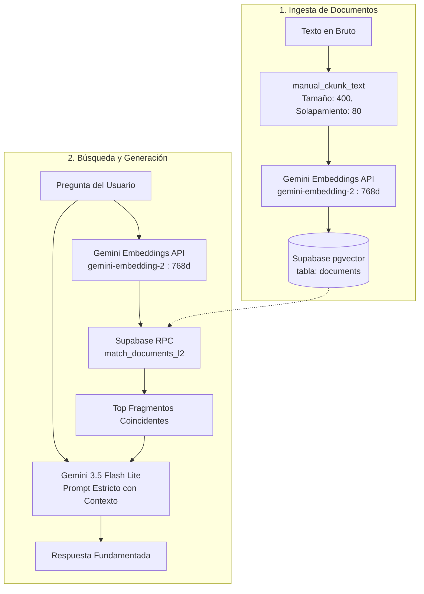

# RAG con Supabase (pgvector) y Google Gemini

[](README.md)
[](https://www.python.org/)
[](https://supabase.com/)
[](https://ai.google.dev/)

Un sistema de Generación Aumentada por Recuperación (RAG - *Retrieval-Augmented Generation*) minimalista y eficiente en Python, utilizando **Supabase (PostgreSQL + pgvector)** para búsqueda por similitud vectorial y el nuevo **SDK de Google GenAI** para generar embeddings y responder preguntas de forma estricta.

---

## 📑 Tabla de Contenidos

- [Descripción General](#descripción-general)
- [Arquitectura](#arquitectura)
- [Características](#características)
- [Configuración de Base de Datos (Supabase)](#configuración-de-base-de-datos-supabase)
- [Requisitos e Instalación](#requisitos-e-instalación)
- [Configuración de Variables de Entorno](#configuración-de-variables-de-entorno)
- [Uso](#uso)
  - [1. Ingesta de Documentos](#1-ingesta-de-documentos)
  - [2. Consultar la Base de Conocimiento](#2-consultar-la-base-de-conocimiento)
- [Estructura del Proyecto](#estructura-del-proyecto)
- [Licencia](#licencia)

---

## Descripción General

Este proyecto ofrece una implementación limpia de un flujo RAG completo:
1. **Fragmentación (Chunking) de Documentos**: Divide textos extensos en bloques con solapamiento (*overlap*), respetando los límites de las palabras para no cortar términos a la mitad.
2. **Embeddings Vectoriales**: Emplea el modelo `gemini-embedding-2` de Google para generar representaciones semánticas en vectores de 768 dimensiones.
3. **Almacenamiento y Recuperación Vectorial**: Guarda fragmentos y vectores en Supabase con la extensión `pgvector`, realizando búsquedas por similitud mediante Distancia Euclidiana ($L_2$).
4. **Generación con Contexto Estricto**: Pasa el contexto más relevante a `gemini-3.5-flash-lite` con directivas estrictas en el prompt para evitar alucinaciones y responder únicamente con la información disponible.

---

## Arquitectura



---

## Características

- **Fragmentación inteligente por palabras**: Evita partir palabras arbitrariamente en los bordes de cada fragmento.
- **Vectores de 768 dimensiones**: Configurados con `EmbedContentConfig(output_dimensionality=768)` a través de la librería moderna `google-genai`.
- **Búsqueda Vectorial por Distancia Euclidiana ($L_2$)**: Función RPC (`match_documents_l2`) en PostgreSQL con umbral de distancia (*threshold*) configurable.
- **Control Antialucinaciones**: El modelo de lenguaje está instruido para ceñirse estrictamente al contexto recuperado o responder con un mensaje predeterminado si el dato no existe.

---

## Configuración de Base de Datos (Supabase)

Antes de iniciar la aplicación, ejecuta el siguiente script en el **Editor SQL de Supabase**:

```sql
-- 1. Habilitar la extensión pgvector
create extension if not exists vector;

-- 2. Crear la tabla de documentos
create table if not exists documents (
    id bigserial primary key,
    content text not null,
    metadata jsonb,
    embedding vector(768)
);

-- 3. Crear el índice para búsqueda vectorial rápida (Distancia L2)
create index if not exists documents_embedding_l2_idx
on documents
using ivfflat (embedding vector_l2_ops)
with (lists = 100);

-- 4. Crear la función RPC para consultar documentos por similitud euclidiana
create or replace function match_documents_l2(
    query_embedding vector(768),
    distance_threshold float default 1.5,
    match_count int default 3
)
returns table (
    id bigint,
    content text,
    metadata jsonb,
    distance float
)
language plpgsql
as $$
begin
    return query
    select
        documents.id,
        documents.content,
        documents.metadata,
        (documents.embedding <-> query_embedding) as distance
    from documents
    where (documents.embedding <-> query_embedding) < distance_threshold
    order by distance asc
    limit match_count;
end;
$$;
```

---

## Requisitos e Instalación

### 1. Clonar el repositorio
```bash
git clone git@github.com:ariigrangetto/rag-embeddings.git
cd rag-embeddings
```

### 2. Crear y activar el entorno virtual
```bash
# En Linux/macOS
python3 -m venv .venv
source .venv/bin/activate

# En Windows (PowerShell)
python -m venv .venv
.venv\Scripts\Activate.ps1
```

### 3. Instalar dependencias
```bash
pip install -r requirements.txt
```

---

## Configuración de Variables de Entorno

Copia el archivo de ejemplo de variables de entorno y completa tus credenciales:

```bash
cp .env.example .env
```

Edita `.env` con tus claves reales:

```env
SUPABASE_URL=https://tu-proyecto.supabase.co
SUPABASE_KEY=tu-clave-supabase-anon-o-service-role
GEMINI_API_KEY=tu-clave-api-google-gemini
```

- **`SUPABASE_URL` y `SUPABASE_KEY`**: Disponibles en la configuración del proyecto en Supabase (sección **API**).
- **`GEMINI_API_KEY`**: Puedes obtenerla en [Google AI Studio](https://aistudio.google.com/).

---

## Uso

### 1. Ingesta de Documentos

Ejecuta el script de ingesta para procesar el texto de ejemplo, generar los embeddings y almacenarlos en la base de datos de Supabase:

```bash
python -m src.ingest
```

### 2. Consultar la Base de Conocimiento

Realiza preguntas sobre los documentos indexados. El sistema buscará los fragmentos más cercanos y generará la respuesta precisa:

```bash
python -m src.query
```

---

## Estructura del Proyecto

```
rag-supabase/
│
├── src/
│   ├── __init__.py
│   ├── config.py         # Carga y validación de variables de entorno
│   ├── client.py         # Inicialización de clientes Supabase y Gemini
│   ├── chunker.py        # Algoritmo de fragmentación de texto por palabras
│   ├── embeddings.py     # Generación de vectores de 768d con Gemini
│   ├── ingest.py         # Ingesta, vectorización y guardado en Supabase
│   └── query.py          # Búsqueda por similitud vectorial (RPC L2) y respuesta RAG
│
├── .env.example          # Plantilla de variables de entorno
├── .gitignore            # Archivos ignorados por Git
├── requirements.txt      # Dependencias del proyecto
├── README.md             # Documentación en Inglés
└── README.es.md          # Documentación en Español
```

---

## Licencia

Este proyecto está bajo la Licencia MIT. Siéntete libre de utilizarlo y adaptarlo a tus necesidades.
