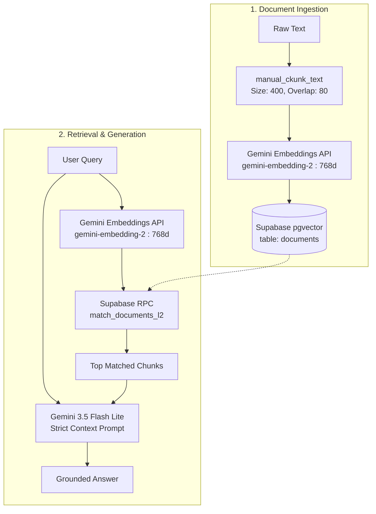

# RAG with Supabase (pgvector) and Google Gemini

[](README.es.md)
[](https://www.python.org/)
[](https://supabase.com/)
[](https://ai.google.dev/)

A minimalist and efficient Retrieval-Augmented Generation (RAG) system built in Python using **Supabase (PostgreSQL + pgvector)** for vector similarity search and the new **Google GenAI SDK** for embedding generation and strict question answering.

---

## 📑 Table of Contents

- [Overview](#overview)
- [Architecture](#architecture)
- [Features](#features)
- [Database Setup (Supabase)](#database-setup-supabase)
- [Prerequisites & Installation](#prerequisites--installation)
- [Environment Configuration](#environment-configuration)
- [Usage](#usage)
  - [1. Ingest Documents](#1-ingest-documents)
  - [2. Query the Knowledge Base](#2-query-the-knowledge-base)
- [Project Structure](#project-structure)
- [License](#license)

---

## Overview

This project provides a clean reference implementation of a complete RAG pipeline:
1. **Document Chunking**: Breaks raw text into smaller overlapping chunks while preserving whole word boundaries.
2. **Vector Embeddings**: Uses Google's `gemini-embedding-2` model to generate 768-dimensional semantic embeddings.
3. **Vector Storage & Retrieval**: Stores chunks and embeddings in Supabase with `pgvector` and performs similarity search using Euclidean Distance ($L_2$).
4. **Context-Grounded Generation**: Feeds relevant context into `gemini-3.5-flash-lite` with strict prompt constraints, preventing hallucinations and ensuring answers are purely based on the provided documents.

---

## Architecture



---

## Features

- **Boundary-aware Chunking**: Chunks text by character window while snapping to word boundaries to avoid broken words.
- **768-dimensional Embeddings**: Configured via `EmbedContentConfig(output_dimensionality=768)` with the modern `google-genai` SDK.
- **Euclidean Distance ($L_2$) Vector Search**: Utilizes PostgreSQL function (`match_documents_l2`) with an adjustable similarity threshold.
- **Hallucination Prevention**: Prompts the LLM strictly to only rely on retrieved context or output a predefined fallback message when information is missing.

---

## Database Setup (Supabase)

Before running the application, set up your PostgreSQL database in the Supabase SQL Editor:

```sql
-- 1. Enable the pgvector extension
create extension if not exists vector;

-- 2. Create the documents table
create table if not exists documents (
    id bigserial primary key,
    content text not null,
    metadata jsonb,
    embedding vector(768)
);

-- 3. Create an index for vector similarity search (L2 distance)
create index if not exists documents_embedding_l2_idx
on documents
using ivfflat (embedding vector_l2_ops)
with (lists = 100);

-- 4. Create the RPC function for vector matching via Euclidean Distance (L2)
create or replace function match_documents_l2(
    query_embedding vector(768),
    distance_threshold float default 1.5,
    match_count int default 3
)
returns table (
    id bigint,
    content text,
    metadata jsonb,
    distance float
)
language plpgsql
as $$
begin
    return query
    select
        documents.id,
        documents.content,
        documents.metadata,
        (documents.embedding <-> query_embedding) as distance
    from documents
    where (documents.embedding <-> query_embedding) < distance_threshold
    order by distance asc
    limit match_count;
end;
$$;
```

---

## Prerequisites & Installation

### 1. Clone the repository
```bash
git clone git@github.com:ariigrangetto/rag-embeddings.git
cd rag-embeddings
```

### 2. Set up a Virtual Environment
```bash
# On Linux/macOS
python3 -m venv .venv
source .venv/bin/activate

# On Windows (PowerShell)
python -m venv .venv
.venv\Scripts\Activate.ps1
```

### 3. Install Dependencies
```bash
pip install -r requirements.txt
```

---

## Environment Configuration

Copy the example environment file and fill in your credentials:

```bash
cp .env.example .env
```

Edit `.env` with your actual keys:

```env
SUPABASE_URL=https://your-project.supabase.co
SUPABASE_KEY=your-supabase-anon-or-service-role-key
GEMINI_API_KEY=your-google-gemini-api-key
```

- **`SUPABASE_URL` & `SUPABASE_KEY`**: Found in your Supabase Project Settings under **API**.
- **`GEMINI_API_KEY`**: Obtain from [Google AI Studio](https://aistudio.google.com/).

---

## Usage

### 1. Ingest Documents

Run the ingestion script to chunk, embed, and store sample documents in Supabase:

```bash
python -m src.ingest
```

### 2. Query the Knowledge Base

Ask questions against the indexed documents. The system will retrieve relevant chunks and generate a factual response:

```bash
python -m src.query
```

---

## Project Structure

```
rag-supabase/
│
├── src/
│   ├── __init__.py
│   ├── config.py         # Loads and validates environment variables
│   ├── client.py         # Initializes Supabase and Gemini clients
│   ├── chunker.py        # Word-boundary text chunker
│   ├── embeddings.py     # Generates 768d vector embeddings with Gemini
│   ├── ingest.py         # Chunking, embedding, and storing in Supabase
│   └── query.py          # Similarity search (L2 RPC) & grounded QA
│
├── .env.example          # Environment variables template
├── .gitignore            # Git ignore file
├── requirements.txt      # Project dependencies
├── README.md             # Documentation in English
└── README.es.md          # Documentación en Español
```

---

## License

This project is licensed under the MIT License. Feel free to use and adapt it for your own applications.
